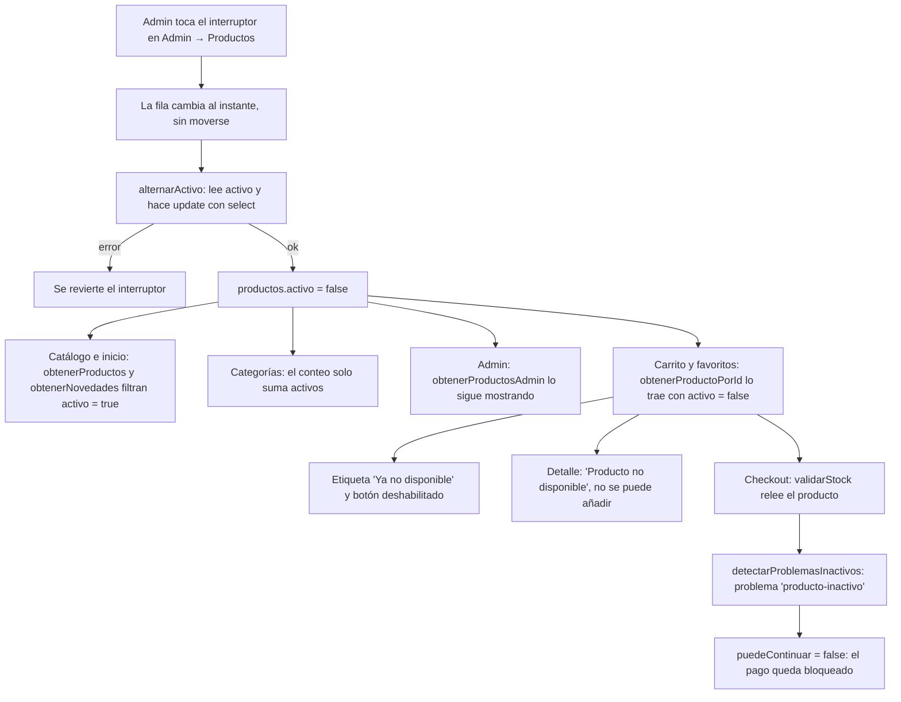
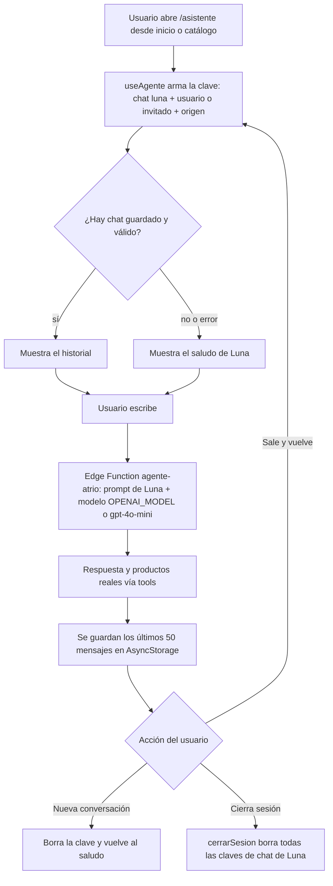
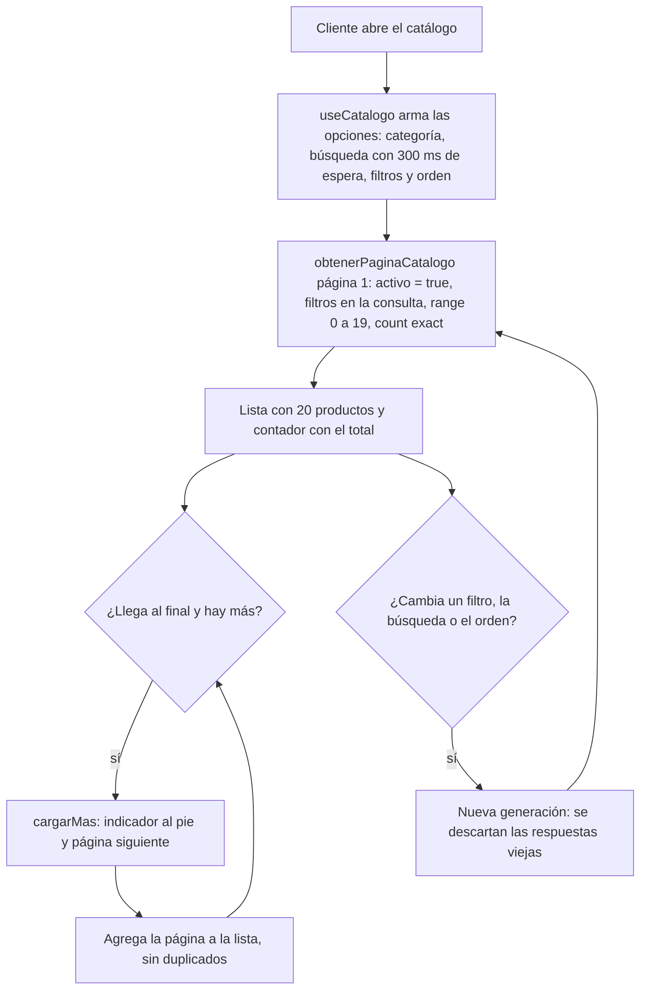

# Auditoría de correcciones — área de Yeiner Carrión

- **Rama:** `yeiner/correcciones`, creada desde `52955ea`.
- **Fecha:** 28 de octubre de 2026.
- **Área:** productos, variantes, stock, catálogo, detalle, carrito, administración de productos y asistente Luna.

## Estado general

Hay tres pasos completos (1, 2 y 5) y dos bloqueados (3 y 4). Los pasos 3 y 4 necesitan la migración del esquema base (`productos`, `variantes_producto`, `imagenes_producto`, `movimientos_stock`, `categorias` y `colores`). Esa migración no existe en `supabase/migrations/`, y por regla no se inventa la estructura de las tablas. Cuando el esquema base esté en la rama, se retoman y este documento se actualiza con un commit nuevo.

**Línea base:** `npm run typecheck` pasaba con 0 errores antes del primer cambio.

**Herramientas que no hay en el entorno:**
- **ESLint:** no está configurado ni instalado en el repo, así que no se corrió `lint`. Instalarlo cuenta como dependencia nueva, y eso requiere aprobación.
- **CLI de Supabase y Docker:** tampoco están instalados. No se probó SQL en local, aunque en los pasos hechos tampoco hubo SQL.

**Cambios previos guardados en un stash:** antes de crear la rama, los cambios sin confirmar de `main` se guardaron en `stash@{0}` ("cambios previos antes de yeiner/correcciones"). Se usó `git stash push` sin `-u`, porque con `-u` se habrían movido `node_modules/` y `.env`. Ese stash no se aplicó ni se modificó. Contiene:
- logs de depuración en el login;
- un cambio en `app/direcciones.tsx`;
- el `.gitignore` que reescribió Expo CLI;
- un primer intento del paso 1 con la opción `incluirInactivos`.

---

## Paso 1: ocultar productos inactivos

### Problema original

`servicioProductos.obtenerProductos`, `obtenerNovedades` y `obtenerCategorias` (en `src/services/servicioProductos.ts`) no filtraban `activo = true`. Un producto desactivado desde el admin seguía apareciendo en el catálogo y en inicio, contaba en su categoría y se podía añadir al carrito.

Durante las pruebas manuales aparecieron cuatro problemas más, que se corrigieron dentro del mismo paso:

1. En Admin → Productos, tocar el interruptor de activo también abría el detalle del producto (`FilaProductoAdmin`: el `Switch` estaba dentro del `Pressable` de la fila).
2. Al activar o desactivar un producto, cambiaba de posición en la lista. Se recargaba la lista entera y `fecha_alta` es solo una fecha, así que los empates volvían en otro orden.
3. En Favoritos, el botón "AÑADIR" seguía activo con productos inactivos y los metía directo al carrito.
4. El interruptor tardaba en responder: `alternarActivo` hacía 3 viajes a Supabase.

### Qué se corrigió

| Archivo | Cambio |
|---|---|
| `src/services/servicioProductos.ts` | `obtenerProductos` y `obtenerNovedades` filtran `activo = true`. Nuevo `obtenerProductosAdmin()` sin ese filtro, que desempata por `id`. `obtenerCategorias` cuenta solo productos activos. `obtenerProductoPorId` sigue sin filtro, a propósito. `alternarActivo` pasa de 3 viajes a 2. |
| `src/hooks/useAdminProductos.ts` | Usa `obtenerProductosAdmin()`. El interruptor cambia la fila al instante, sin recargar la lista, y revierte el cambio si Supabase lo rechaza. |
| `src/services/servicioAdmin.ts` | Usa `obtenerProductosAdmin()` en el dashboard y en el stock bajo. |
| `src/components/admin/FilaProductoAdmin.tsx` | El `Switch` queda fuera del `Pressable` que abre el detalle. |
| `src/hooks/useDetalleProducto.ts` | `errorSeleccion` pasa a ser `string \| null`. Con un producto inactivo, `agregarAlCarrito` devuelve `false` con el mensaje "Este producto ya no está disponible." |
| `app/producto/[id].tsx` | Aviso "Producto no disponible" y botón "NO DISPONIBLE" deshabilitado. |
| `src/components/cart/ItemCarrito.tsx` | Etiqueta "Ya no disponible". |
| `src/components/products/FilaFavorito.tsx` | Etiqueta "Ya no disponible" y botón deshabilitado. |
| `src/types/Checkout.ts` (Segundo) | Nuevo código `'producto-inactivo'` en `ProblemaCheckout`. |
| `src/utils/checkout.ts` (Segundo) | Nueva función `detectarProblemasInactivos`. `detectarProblemasStock` deja de reportar inactivos para no duplicar el aviso; Yeiner aprobó este cambio. |
| `src/hooks/useCheckout.ts` | `validarStock` suma `detectarProblemasInactivos`, así que el pago queda bloqueado. |

`src/services/servicioReportes.ts` no se tocó, por decisión de Yeiner. Sigue usando `obtenerProductos()`, que ahora devuelve solo activos. Ahí solo se usa para generar pedidos de ejemplo, así que no se rompe nada.

### Flujo de funcionamiento



### Cómo se validó

- `npm run typecheck`: 0 errores después de cada commit.
- `lint`: no disponible (ver arriba).
- **SQL:** no aplica.
- Antes de cambiar firmas se buscaron con grep todos los usos de `obtenerProductos`, `errorSeleccion`, `alternarActivo` y `codigo`. No hay ningún `switch` sobre `codigo` que se rompa con el valor nuevo.
- **Pruebas manuales de Yeiner:**
  - desactivó productos desde el admin;
  - encontró y reportó los 4 problemas de la lista de arriba;
  - confirmó la corrección de Favoritos.

  No consta una pasada final completa de todas las pruebas: catálogo, inicio, conteo de categoría y bloqueo del checkout.

### Riesgos y pendientes

- **Carrito de invitado:** se guarda en el dispositivo con una copia del producto, así que la etiqueta solo aparece si el producto ya estaba inactivo al añadirlo. Aun así, el checkout siempre lo bloquea, porque relee el producto.
- **Depende de Alexander:** si la política RLS de `productos` oculta los inactivos a los clientes, `obtenerProductoPorId` devuelve `undefined` para ellos. En ese caso la línea desaparece del carrito sin aviso (`servicioCarrito.obtenerItems` la ignora) y el detalle muestra "Producto no encontrado". También hay que confirmar que `confirmar_compra` rechace productos inactivos en el servidor.
- **Doble toque rápido:** si se toca el interruptor dos veces muy seguido, se lanzan dos peticiones. La interfaz termina mostrando lo que devuelve la última.

---

## Paso 2: corregir a Luna

### Problema original

- `supabase/functions/agente-atrio/openai.ts`: el modelo por defecto era `gpt-5.6-luna`, que no es un id publicado por OpenAI. Si el secreto `OPENAI_MODEL` no estaba definido, todas las llamadas fallaban.
- `supabase/functions/agente-atrio/index.ts`: el `SYSTEM_PROMPT` no le daba nombre a la asistente.
- `src/hooks/useAgente.ts`: el chat vivía solo en memoria y se perdía al salir de la pantalla.

### Qué se corrigió

| Archivo | Cambio |
|---|---|
| `supabase/functions/agente-atrio/openai.ts` | `MODELO_POR_DEFECTO = 'gpt-4o-mini'` y comentario actualizado. |
| `supabase/functions/agente-atrio/index.ts` | El prompt empieza con "Te llamas Luna y eres la asistente virtual de ATRIO, una tienda de ropa." El resto de reglas no cambió. |
| `src/services/storageService.ts` | Nueva clave `chatLuna: 'atrio.chat.luna'` y nueva función `eliminarDatosConPrefijo()`. |
| `src/hooks/useAgente.ts` | Saludo de Luna. Carga y guarda el chat con la clave `atrio.chat.luna.<usuarioId \| invitado>.<origen>`, hasta 50 mensajes. Valida lo leído; si falla, empieza con el saludo. `limpiarConversacion`, que no se usaba, pasa a ser `nuevaConversacion()` y además borra lo guardado. Se partió del último commit, con sus comentarios originales. |
| `app/asistente.tsx` | Título "Luna" y botón "Nueva conversación", deshabilitado mientras responde o si solo está el saludo. |
| `src/services/servicioAutenticacion.ts` (Alexander) | `cerrarSesion` borra todas las claves `atrio.chat.luna*` al inicio, también con la huella activa. |

### Flujo de funcionamiento



### Cómo se validó

- `npm run typecheck`: 0 errores. La Edge Function es Deno y `tsc` no la revisa; el cambio son dos cadenas de texto y se revisó a mano.
- `lint`: no disponible.
- **SQL:** no aplica.
- Se buscaron con grep todos los usos de `useAgente` y `limpiarConversacion`. Se confirmó que `/asistente` está dentro de `AuthProvider`, así que `useAuth` funciona ahí.
- **Pruebas manuales:** pendientes. Necesitan desplegar antes la función (ver comandos). No consta que Yeiner las haya hecho.

### Riesgos y pendientes

- Sin `supabase functions deploy agente-atrio`, Luna en producción sigue con el prompt y el modelo viejos.
- **Costo:** la API de OpenAI cobra por uso a la cuenta dueña de `OPENAI_API_KEY`. Se recomienda poner un tope mensual en Billing → Limits.
- Si el usuario sale de la pantalla mientras Luna responde, esa respuesta se pierde. La pregunta sí queda guardada.
- `supabase/config.toml`, línea 7, todavía tiene el comentario de ejemplo `OPENAI_MODEL=gpt-5.6-luna`. No se tocó porque no estaba en el alcance.

---

## Paso 3: guardar el producto en una sola transacción — BLOQUEADO

### Problema original

`servicioProductos.crearProducto` hace 3 inserciones y `actualizarVariantesEImagenes` hace hasta 5 operaciones, todas desde el celular (`src/services/servicioProductos.ts`, usadas en `src/hooks/useFormularioProducto.ts`). Si una falla a la mitad, el producto queda incompleto: sin variantes, sin fotos o con el stock a medias.

### Estado

No se implementó. La función `public.guardar_producto` necesita las columnas y restricciones reales de `productos`, `variantes_producto`, `imagenes_producto` y `movimientos_stock`, y esa migración base no está en el repo. No se modificó ningún archivo.

### Riesgos y pendientes

- El riesgo de productos a medio guardar sigue en producción.
- Para retomarlo, Yeiner debe traer el esquema base a la rama.

---

## Paso 4: admin de categorías, colores y campañas — BLOQUEADO

### Problema original

Las categorías, los colores y las campañas solo se pueden editar desde el dashboard de Supabase. No hay pantallas en `app/admin/` ni políticas RLS de escritura para `categorias` y `colores`.

### Estado

No se implementó: depende del mismo esquema base que el paso 3. No se creó ninguna migración, servicio, hook ni pantalla.

### Riesgos y pendientes

- Hasta entonces, la gestión sigue hecha a mano desde el Table Editor, que usa `service_role`.

---

## Paso 5: paginar el catálogo

### Problema original

`src/hooks/useCatalogo.ts` descargaba todos los productos de una vez con `obtenerProductos()` y filtraba y ordenaba en memoria. "Cargar más" solo cortaba esa lista con `slice`. Con un catálogo grande, eso son descargas lentas y mucho uso de memoria y datos.

### Qué se corrigió

| Archivo | Cambio |
|---|---|
| `src/services/servicioProductos.ts` | Nueva función `obtenerPaginaCatalogo(...)` (detalle abajo). |
| `src/hooks/useCatalogo.ts` | Paginación en el servidor. Vuelve a la página 1 cuando cambian los filtros, la búsqueda o el orden, y `cargarMas` agrega la página siguiente. Descarta respuestas tardías y la búsqueda espera 300 ms. Devuelve lo mismo que antes, más `cargandoMas`. |
| `app/(tabs)/catalogo.tsx` | Indicador de carga al pie de la lista. |

Detalle de `obtenerPaginaCatalogo(...)`:
- Trae solo productos activos, de 20 en 20 con `.range()`.
- Los filtros van en la consulta:
  - categoría y precio máximo;
  - búsqueda por nombre o por nombre de categoría, combinadas con `or`;
  - tallas, colores y "solo disponibles", con embeds `!inner` con alias. Así cada producto sigue trayendo todas sus variantes.
- Usa `count: 'exact'` para el contador de resultados.
- Desempata por `fecha_alta` y luego por `id`.
- Devuelve `{ productos, hayMas, total }`. Se agregó `total` porque la pantalla muestra "N RESULTADOS".

### Flujo de funcionamiento



### Cómo se validó

- `npm run typecheck`: 0 errores.
- `lint`: no disponible.
- **SQL:** no aplica.
- Se revisó que `useCatalogo` solo se use en `catalogo.tsx` y que `FiltrosCatalogo` y `OrdenCatalogo` sigan iguales para `PanelFiltros`.
- **Comparación antes y después:** se escribió un script (fuera del repo, en el scratchpad de la sesión) que compara 4 combinaciones de filtros con valores reales:
  1. todo;
  2. talla + color + "solo disponibles", ordenado por precio;
  3. categoría + búsqueda + precio máximo, ordenado por popularidad;
  4. búsqueda por nombre de categoría.

  Revisa que no falten ni sobren productos, que no haya repetidos, que el total sea el mismo y que lleguen todas las variantes. No se ejecutó: consulta la base de producción (solo lectura) y necesitaba autorización. No consta que Yeiner lo haya corrido.
- **Pruebas manuales de Yeiner:** revisó el panel de filtros y el comportamiento de "LIMPIAR". No consta el resto de las pruebas.

### Riesgos y pendientes

- **Sin verificar contra Supabase:** el filtrado por variantes con alias `!inner`. Si PostgREST lo rechaza, el catálogo mostraría un error al usar filtros de color o "solo disponibles". El script de comparación lo detecta.
- **Filtro de talla sin interfaz:** `FiltrosCatalogo.tallas` existe y se filtra en el servidor, pero `PanelFiltros` nunca tuvo una sección para elegir talla. Se propuso agregarla y quedó pendiente por decisión de Yeiner.
- Cada cambio de filtro ahora es una consulta a la red. Con conexión lenta, los resultados anteriores siguen en pantalla hasta que llegan los nuevos.
- "Sin resultados" se ve un instante mientras carga la primera página. Pasaba igual antes del cambio.
- `obtenerProductos()` ya no se usa en el catálogo. Se mantiene por compatibilidad: la usa `servicioReportes` para los datos de ejemplo.

---

## Tabla resumen

| Paso | Archivos tocados | Estado | Quién debe revisar |
|---|---|---|---|
| 1. Ocultar inactivos | `servicioProductos.ts`, `useAdminProductos.ts`, `servicioAdmin.ts`, `FilaProductoAdmin.tsx`, `useDetalleProducto.ts`, `app/producto/[id].tsx`, `ItemCarrito.tsx`, `FilaFavorito.tsx`, `Checkout.ts`, `utils/checkout.ts`, `useCheckout.ts` | Completo (faltan pruebas manuales finales) | Yeiner; Segundo (checkout); Alexander (RLS y `confirmar_compra`) |
| 2. Luna | `openai.ts`, `agente-atrio/index.ts`, `storageService.ts`, `useAgente.ts`, `app/asistente.tsx`, `servicioAutenticacion.ts` | Completo (falta desplegar y probar) | Yeiner; Alexander (`cerrarSesion`) |
| 3. Transacción `guardar_producto` | — | Bloqueado: falta el esquema base | Yeiner |
| 4. Admin de categorías, colores y campañas | — | Bloqueado: falta el esquema base | Yeiner |
| 5. Paginación del catálogo | `servicioProductos.ts`, `useCatalogo.ts`, `app/(tabs)/catalogo.tsx` | Completo (falta la comparación contra la base) | Yeiner |

## Comandos que debe correr Yeiner

Ninguno se ejecutó desde esta rama.

```bash
# Paso 2: modelo de Luna y despliegue de la función
supabase secrets set OPENAI_MODEL=<modelo disponible en la cuenta de OpenAI>
supabase functions deploy agente-atrio

# Paso 5: comparación antes/después del catálogo (solo lectura), desde la raíz del repo
node <ruta-del-script>/comparar-catalogo.mjs
```

No hay migraciones nuevas que aplicar: los pasos 3 y 4, que las traían, están bloqueados.

## Revisión de seguridad

- **No hay claves en el código.** Se buscaron JWT, `sk-`, URLs de Supabase, `service_role`, `apikey` y contraseñas en todo el diff de la rama (`52955ea..HEAD`), sin resultados. El script de comparación lee `.env` en tiempo de ejecución y no imprime sus valores. Este documento tampoco contiene secretos.
- **Funciones SQL nuevas y rol de administrador:** no aplica. No se creó ninguna función ni migración SQL, porque los pasos 3 y 4 están bloqueados. Cuando se hagan, cada función debe empezar verificando `perfiles.rol = 'administrador'`.
- **Ninguna pantalla nueva es visible para clientes:** no se creó ninguna pantalla nueva. Los cambios en pantallas existentes son avisos y botones deshabilitados (detalle, carrito, favoritos), el título y el botón de Luna, y el indicador del catálogo. Las pantallas del admin siguen protegidas por `app/admin/_layout.tsx`, que no se tocó.
- **Ningún archivo cambió fuera de lo indicado**, con estas excepciones, todas pedidas o aprobadas por Yeiner durante las pruebas:
  - `src/components/admin/FilaProductoAdmin.tsx`: arreglo del interruptor que abría el detalle.
  - `src/hooks/useAdminProductos.ts` y `alternarActivo` en `servicioProductos.ts`: posición estable y respuesta inmediata del interruptor.
  - `src/utils/checkout.ts`, en `detectarProblemasStock`: una condición, para no duplicar el aviso de inactivo.
  - `src/services/storageService.ts`, con la función `eliminarDatosConPrefijo`: necesaria para borrar los chats al cerrar sesión.

  No se tocaron checkout, pagos, pedidos, autenticación (salvo la línea indicada en `cerrarSesion`), perfil, configuración ni reportes. No se implementó el generador de outfits. No se instalaron dependencias. No hubo `push`, `merge` ni `--force`.

## Avisos a otros integrantes

- **Segundo:**
  - `src/types/Checkout.ts`: código nuevo `'producto-inactivo'`.
  - `src/utils/checkout.ts`: función nueva `detectarProblemasInactivos`; `detectarProblemasStock` ya no reporta inactivos.
  - `src/hooks/useCheckout.ts`: `validarStock` llama a la función nueva.
- **Alexander:**
  - `src/services/servicioAutenticacion.ts`: `cerrarSesion` borra los chats de Luna al inicio.
  - Confirmar en la base:
    - si la política de lectura de `productos` deja ver los inactivos a los clientes (afecta cómo se ven en carrito y detalle);
    - que `confirmar_compra` rechaza productos inactivos.
